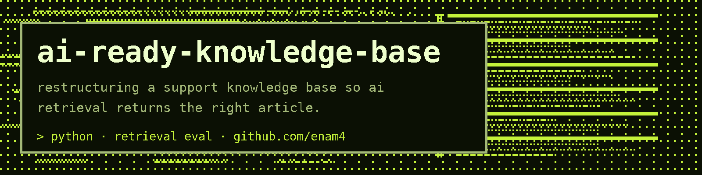
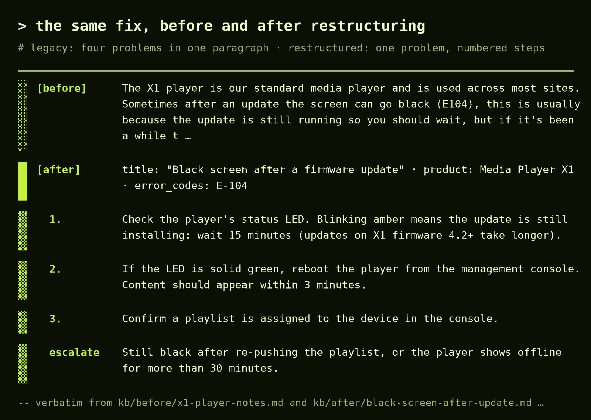
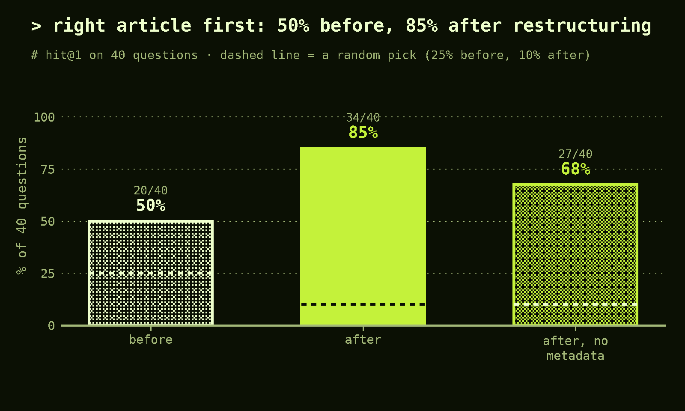
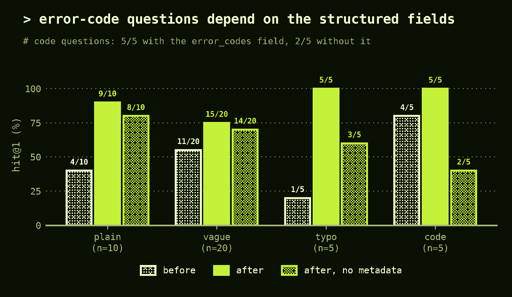

**How I restructure a support knowledge base so AI retrieval returns the right answer, and how I test that it worked.**

## ░ At a glance

```text
┌────────────────────────────────────────────────────────────────────────┐
│ problem       Support knowledge bases are written for people skimming  │
│               a page: one page covers several issues, steps are buried │
│               in prose, and old pages stay up next to new ones. An AI  │
│               assistant searching that content often returns the wrong │
│               page, an out-of-date fix, or a page where most of the    │
│               text is about something else.                            │
│ what i built  An article standard for AI retrieval, a linter that      │
│               checks every article against it, and a retrieval eval    │
│               that runs the same 40 support questions against the old  │
│               and the restructured knowledge base.                     │
│ result        On this repo's fictional knowledge base, the right       │
│               article came first for 34 of 40 questions after          │
│               restructuring, against 20 of 40 before. Before, an out-  │
│               of-date page came first for 7 questions; after, for      │
│               none.                                                    │
│ stack         Python (standard library only), SQLite, the search       │
│               engine from my KBsearch project. Built with Claude Code. │
└────────────────────────────────────────────────────────────────────────┘
```

At L Squared Digital, a digital-signage SaaS company, I reworked 300+ support articles so our AI knowledge-base search could use them, and tested retrieval with scored test questions. That content belongs to the company, so this repo recreates the method on a fictional knowledge base for made-up products (the X1 and X2 Pro media players, the K1 kiosk and two commercial displays). **Every number below comes from that fictional set, not from the company's knowledge base.**

## ░ What makes an article AI-ready

1. **One problem per article.** Retrieval returns whole articles or chunks, so a page about four problems returns four answers.
2. **The title is the symptom a customer would describe.** "Black screen after a firmware update", not "X1 Player Notes (updated)".
3. **Structured fields up top:** product, category, symptom phrases and error codes, so search can match on them directly.
4. **Numbered steps, one action each**, so an assistant can quote them back exactly.
5. **An explicit escalation condition**, so the assistant knows when to stop and hand off.
6. **No "see above".** Each article has to make sense on its own, because it will be read on its own.
7. **Dated and owned**, so stale articles can be found and someone is responsible for them.

The full template is in [`ARTICLE-TEMPLATE.md`](ARTICLE-TEMPLATE.md).

## ░ Before and after



The "before" knowledge base ([`kb/before/`](kb/before/)) is four legacy pages written to reproduce the problems I fixed at work. One page covers four issues in one paragraph, steps are in prose, one page says "see above", and an old 2025 firmware FAQ still recommends a factory reset that current guidance no longer uses. Here's an excerpt from [`x1-player-notes.md`](kb/before/x1-player-notes.md):

> Sometimes after an update the screen can go black (E104), this is usually because the update is still running so you should wait, but if it's been a while then a reboot from the console usually fixes it, if not try re-pushing the playlist. Also if the screen says no signal check the HDMI and the input on the display...

The "after" knowledge base ([`kb/after/`](kb/after/)) covers the same ten issues as ten articles written to the template, for example [`black-screen-after-update.md`](kb/after/black-screen-after-update.md):

```markdown
---
title: "Black screen after a firmware update"
product: "Media Player X1"
category: "playback"
symptoms: ["black screen", "display on but no content", "screen went black after update"]
error_codes: ["E-104"]
last_reviewed: "2026-11-02"
owner: "Support - Tier 1"
---
## Steps
1. Check the player's status LED. Blinking amber means the update is still installing: wait 15 minutes ...
2. If the LED is solid green, reboot the player from the management console ...
## Escalate if
- Still black after re-pushing the playlist, or the player shows offline for more than 30 minutes.
```

## ░ How the eval works

[`tools/kb_eval.py`](tools/kb_eval.py) indexes each version of the knowledge base with the search engine from KBsearch ([`tools/kb.py`](tools/kb.py), copied unchanged) and asks the 40 questions in [`eval/questions.csv`](eval/questions.csv). Each question is labelled with the issue it's about and a style: plain (10), vague (20), typo (5) or error code (5). I wrote the questions before running the eval and didn't change them afterwards.

It compares three versions:

- **before:** the 4 legacy pages.
- **after:** the 10 restructured articles.
- **after, no metadata:** the same 10 articles with product, category, symptoms and error code removed. This shows how much of the gain comes from the structured fields and how much from splitting and rewriting.

Hidden markers in the legacy pages record which issue each sentence is about and which passages are out of date. The eval strips them before indexing, then uses them to score whether the top result covers the question's issue, whether it's the stale page, and what share of the returned text is about the question. There are no model calls and no randomness, so `python tools/kb_eval.py` reproduces every number here.

## ░ Results



From [`eval/results.md`](eval/results.md):

| | before | after | after, no metadata |
|---|---|---|---|
| Articles in the index | 4 | 10 | 10 |
| Right article first (hit@1) | 20/40 (50%) | 34/40 (85%) | 27/40 (68%) |
| Right article in top 3 (hit@3) | 37/40 (92%) | 38/40 (95%) | 38/40 (95%) |
| Chance of hit@1 by random pick | 25% | 10% | 10% |
| Stale page returned first | 7/40 (18%) | 0/40 (0%) | 0/40 (0%) |
| Share of the top result's words about the question, when right | 28% | 100% | 100% |
| Top result usable as-is (right article, numbered steps, escalation rule) | 0/40 | 34/40 | 27/40 |



| Hit@1 by question style | before | after | after, no metadata |
|---|---|---|---|
| plain | 4/10 | 9/10 | 8/10 |
| vague | 11/20 | 15/20 | 14/20 |
| typo | 1/5 | 5/5 | 3/5 |
| code | 4/5 | 5/5 | 2/5 |

What I take from it:

- **Restructuring improved hit@1 from 50% to 85%,** even though the restructured set has more than twice as many articles to choose from. A random pick would be right 25% of the time before and 10% after.
- **The stale page was the biggest single source of wrong answers.** It came first for 7 questions, all about black screens or Wi-Fi, and its out-of-date advice would have had an agent factory reset a player or plug a keyboard in on site. Deleting stale content mattered as much as rewriting the good content.
- **When the old knowledge base did return the right page, only 28% of it was about the question.** The agent, or the AI model, has to find the answer inside a paragraph about three other problems.
- **The structured fields account for about half the gain** (85% with them, 68% without). Error-code questions depend on them almost completely: 5/5 with the field and 2/5 without, because exact error-code matching only works when the code is stored as a field.
- **Hit@3 doesn't separate the versions.** With only 4 legacy pages, the top 3 is three-quarters of the whole knowledge base, so 92% says little.

## ░ Where it still fails

Six questions still miss after restructuring. They're listed in [`eval/results.md`](eval/results.md#misses). Most share a cause: KBsearch's search engine compares words, not meaning. "Content is showing sideways" returns "New content not showing" because the word "content" outweighs "sideways", and "display is on but can't find a source" never mentions "no signal", the phrase the right article uses. Better articles can't fully fix that. A real embedding model, or more symptom phrases written the way customers talk, would be the next step.

## ░ The linter

[`tools/kb_lint.py`](tools/kb_lint.py) checks each article against the standard: required fields, a symptom-led title, at least two numbered steps, an escalation condition, a summary, no back-references, one issue per article, and a review date within 180 days. It exits with an error if any article fails, so it can run in CI or before each sync to the search index.

```
$ python tools/kb_lint.py kb/after kb/before --today 2026-11-18   (summary lines only)
10/14 articles pass
  fields: 4  title: 4  steps: 4  escalation: 4  summary: 4  self-contained: 1  one-issue: 1
```

All 10 restructured articles pass and all 4 legacy pages fail. The one-issue check is a rough heuristic (more than one error code, or more than 250 words). It caught the FAQ page but missed the X1 notes page, which covers four issues in 142 words with one error code. Detecting several issues in a short page reliably needs more than a word count.

## ░ Run it

Python 3.10+, no installs.

```
python tools/kb_lint.py kb/after kb/before --today 2026-11-18
python tools/kb_eval.py
python -m unittest discover tests
```

The charts in `assets/` are rebuilt from `eval/results_per_question.csv` by `python make_figures.py`, which needs `matplotlib`, `numpy` and `pillow`. The tools above don't.

## ░ Limits

- **The data is fictional.** I wrote both versions of the knowledge base and the questions myself, to reproduce problems I fixed at work. The numbers show how the method handles those problems; they are not a measurement of a real knowledge base.
- **Same author for the content and the questions.** I wrote the questions before running the eval, but someone who knows the articles may phrase questions closer to them than a real agent would. Questions taken from real agent searches would be a fairer test.
- **One search engine.** KBsearch uses hashed word and character features, not a neural embedding model, so results with a semantic model would differ.
- **Small set:** 10 issues and 40 questions. One question is 2.5 percentage points.

## ░ What I'd do next

- Re-run the eval with an embedding model, to see which gains hold when the search understands paraphrase.
- Replace the hand-written questions with real, anonymised agent searches, including the ones that found nothing.
- Make the linter check every article change before it's synced to the search index, and flag articles past their review date automatically.

## ░ Repo layout

```
ARTICLE-TEMPLATE.md      the article standard
kb/before/               4 legacy pages (fictional), with hidden issue markers for scoring
kb/after/                10 restructured articles (fictional)
eval/questions.csv       40 test questions with expected issue and style
eval/results.md          generated results, including every miss
tools/kb.py              search engine, copied unchanged from KBsearch
tools/kbmd.py            loads both article formats
tools/kb_lint.py         article linter
tools/kb_eval.py         retrieval eval
tests/test_tools.py      11 tests
make_figures.py          builds the charts in assets/ (dithered; style in figstyle.py)
```
